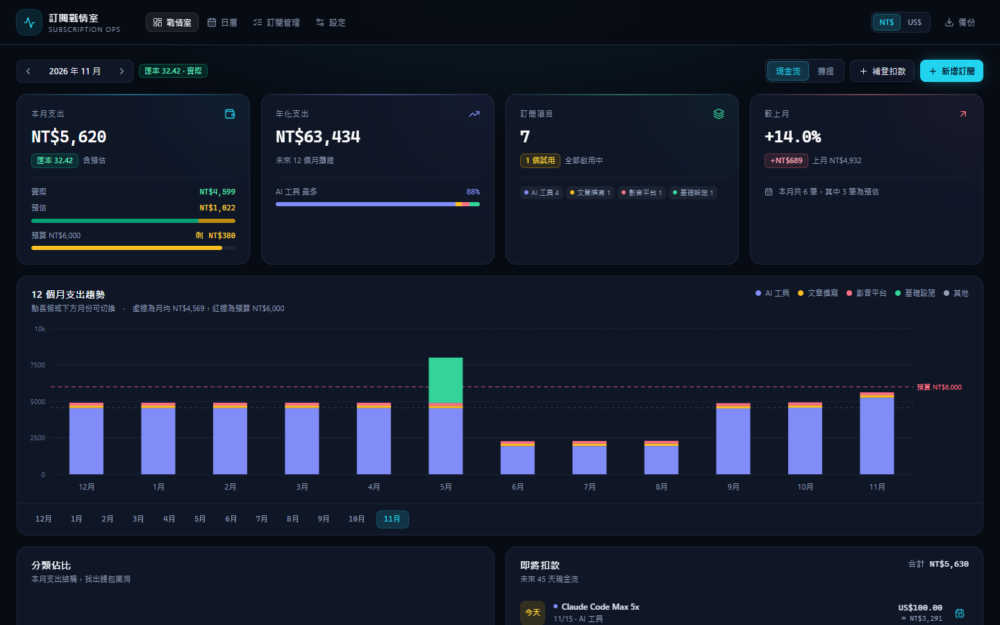
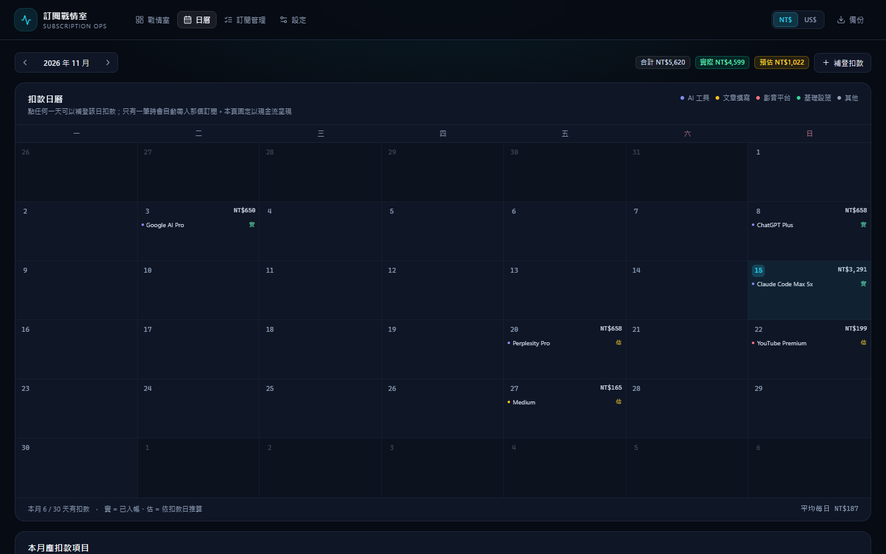
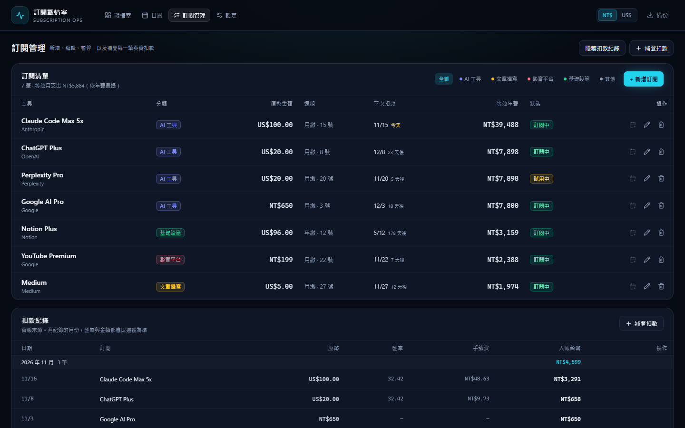
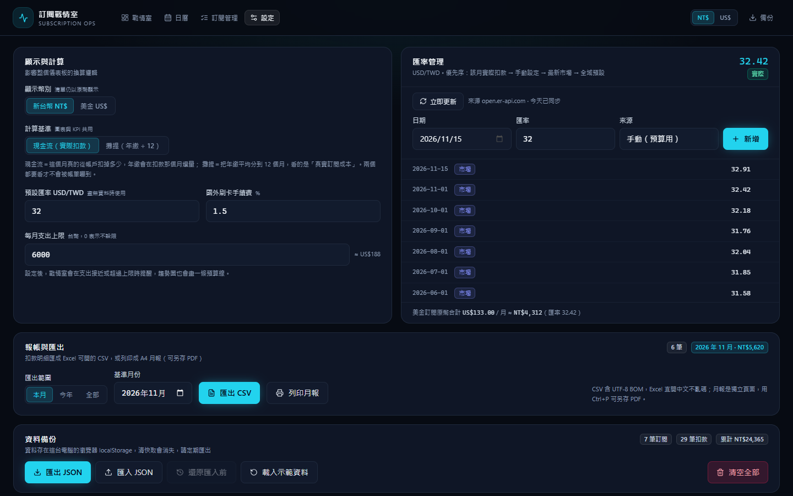

# 訂閱戰情室 · Subscription Ops

記錄每個月付了哪些訂閱（AI 工具、寫作、影音），並算出「這個月到底花多少、還能花多少」。

解決三個容易算錯的情況：**美金＋台幣混用**、**月繳＋年繳混用**、**實際扣款 vs 估算**。

---

## 快速開始（約 2 分鐘）

需要 Node.js 18.18 以上（建議 20+）。

```bash
npm install
npm run dev        # 開 http://localhost:5173
```

第一次打開會自動載入一組示範資料（以「今天」往前推 6 個月），所以不會是空畫面。確定要開始記自己的帳時，到 **設定 → 清空全部**。

線上版 <https://kennykang7012.github.io/subscription-ops/> 第一次打開也是同一組示範資料——因為資料存在瀏覽器裡，而每個網域各自獨立，所以線上版看不到你本機 `localhost` 的紀錄；要搬過去就用 **設定 → 匯出 JSON → 匯入 JSON**。

打開後會有四個頁面：

| 頁 | 用途 | 什麼時候用 |
|---|---|---|
| **戰情室** | 本月支出、年化、趨勢圖、分類佔比、即將扣款、省錢洞察 | 想知道「這個月花了多少」 |
| **日曆** | 每天扣了多少，點日期直接補登 | 收到帳單要記一筆 |
| **訂閱管理** | 訂閱清單、暫停/取消、扣款紀錄 | 新增或修改訂閱 |
| **設定** | 幣別、預算、匯率、報帳匯出、備份 | 第一次設定、月底匯出 |

---

## 介面預覽

**戰情室** — 本月支出（實際 / 預估）、年化、12 個月趨勢、玫瑰色虛線是每月預算



**日曆** — 每天扣了多少，點日期直接補登；實 = 已入帳、估 = 依扣款日推算



**訂閱管理** — 依等效年費排序，右側可補登 / 編輯 / 刪除



**設定** — 幣別與基準、每月上限、匯率來源、報帳匯出、資料備份



> 截圖用的是首次載入的示範資料，數字都是真的算出來的。

---

## 第一次設定（約 5 分鐘）

1. **設定 → 清空全部**（拿掉示範資料）
2. **訂閱管理 → + 新增訂閱**
   填「原幣」金額就好，例如 ChatGPT Plus 填 `20` + `US$`，不用自己換台幣
3. **設定 → 每月支出上限** 填一個數字（例：`6000`），戰情室就會出現預算進度條；填 `0` 表示不設限
4. **確認匯率**：設定頁上方會顯示目前的 USD/TWD 與來源徽章，按「立即更新」可重抓
5. **補登本月已扣的款**：到訂閱管理，把滑鼠移到該列最右邊的 📅 圖示

之後每月只要做一件事：**把當月已經扣掉的帳補登進去**。

---

## 日常怎麼用

**每月（約 2 分鐘）**
1. 看戰情室的「即將扣款」，知道接下來誰要扣
2. 帳單來的時候，到訂閱管理按 📅 補登（金額、匯率、手續費會自動算好）
3. 有補登的月份，KPI 就會從「預估」變成「實際」

**隨時**
- 點日曆上任何一天 → 直接補登那天的扣款
- 點趨勢圖的長條或下方月份 → 切換上方 KPI 的月份
- 右上角「備份」→ 匯出 JSON（建議每月做一次）

**月底要報帳時**
設定 → 報帳與匯出 → 選範圍（本月／今年／全部）→ 匯出 CSV（Excel 直開）或列印月報（可另存 PDF）

---

## 三個一定要懂的概念

### 1. 原幣 vs 台幣

你填的永遠是**原幣**（US$20、NT$650），系統存在原幣，台幣只在顯示時換算。
所以**之後調匯率不會污染歷史紀錄**，已補登的扣款也永遠是當時的入帳金額。

### 2. 實際 vs 預估

| 標記 | 意思 |
|---|---|
| **實際**（綠） | 有扣款紀錄，用真實入帳金額與匯率 |
| **預估**（黃） | 還沒補登，依扣款日推算，含 1.5% 手續費 |

戰情室的「本月支出」兩者都算。想只看實帳，看旁邊的「實際 NT$…」那一行。

### 3. 現金流 vs 攤提

同樣的訂閱，兩種算法差很多：

| 切換 | 算法 | 什麼時候看 |
|---|---|---|
| **現金流** | 這個月真的從帳戶扣掉多少（年繳會在扣款當月爆量） | 想知道「這個月帳單多痛」 |
| **攤提** | 年繳 ÷ 12，平均分到每個月 | 想知道「這些訂閱的真實成本」 |

年繳 NT$3,120 的方案：現金流看是「5 月花 3,120」，攤提看是「每月 260」。

---

## 名詞對照

| 名詞 | 意思 |
|---|---|
| 原幣金額 | 服務實際計價的幣別金額（US$20 / NT$650） |
| 入帳台幣 | 實際從帳戶扣掉的台幣，含國外交易手續費 |
| 手續費 | 國外刷卡約 1.5%，台幣計價的服務不收，可在設定調整 |
| 等效年費 | 把月繳 ×12、年繳原價，換算成台幣的一年成本 |
| 匯率徽章 | 這個數字用的匯率從哪來：實際／手動／市場／預設 |

---

## 常見問題

**Q：數字跟信用卡帳單對不上？**
先看三件事：① 那筆是「預估」還是「實際」② 手續費率設定是否 1.5% ③ 匯率徽章是哪一種。有補登的月份一定以實帳為準，剩下的是估算。

**Q：年繳要怎麼記？**
週期選「年繳」並填「扣款月份」，系統不會把它算成 12 個月各扣一次。

**Q：漲價了怎麼辦？**
直接改訂閱金額，**只影響之後的估算**，已補登的歷史不變。省錢洞察會自動標出「某工具漲價了，一年多花多少」。

**Q：取消訂閱後，過去的支出會消失嗎？**
不會。改成「已取消」時會自動補上結束日，歷史月份照樣算得出來；改回「訂閱中」會自動清掉結束日。

**Q：試用期怎麼記？**
狀態選「試用中」並填「試用到期日」，7 天內會出現在省錢洞察裡。

**Q：刪錯東西怎麼辦？**
刪訂閱會**連同它的所有扣款一起刪，無法復原**（單筆扣款可以單獨刪）。所以刪之前先按右上角「備份」。「還原匯入前」只適用於匯入覆蓋的場合。

**Q：資料會不見嗎？**
資料存在這台電腦的瀏覽器（`localStorage`，key：`ai-tools-subscription-v1`）。**清瀏覽器資料、換瀏覽器、無痕模式都會看不到**，所以請定期匯出 JSON。

**Q：怎麼換到另一台電腦？**
舊電腦「備份」匯出 JSON → 新電腦的「設定 → 匯入 JSON」。目前沒有自動同步，要兩台同時用只能手動搬。

**Q：可以記不是訂閱的單筆支出嗎？**
目前「補登扣款」一定要綁一個訂閱。獨立支出（例如買斷的軟體）先建一個「單次」週期的訂閱來記。

**Q：匯率一直顯示「預設」？**
代表查不到任何匯率資料。到設定按「立即更新」，或手動加一筆（日期 + 匯率）。

---

## 資料在哪、怎麼備份

- 存在瀏覽器 `localStorage`，key `ai-tools-subscription-v1`
- 右上角「備份」＝ 匯出 JSON；設定頁可匯入還原
- 匯入前會自動存一份快照，可用「還原匯入前」一鍵回復
- 唯一的外部連線是匯率 API（`open.er-api.com`，一天一次，只查 USD 匯率，不上傳任何記帳資料）

---

以下給要改這個專案的人。

## 為什麼這樣設計

| 痛點 | 這裡怎麼處理 |
|---|---|
| 美金訂閱每月的台幣金額都不同 | 每筆扣款存「當下匯率 + 手續費 + 入帳台幣」；估算時才用解析出來的匯率 |
| 年繳不能算成月繳，也不能全算在扣款當月 | 現金流／攤提雙基準 |
| 預計 2,000 實際扣 2,137 | KPI 同時顯示「實際 / 預估」並標示匯率可信度 |

## 匯率解析優先序

畫面上的數字會標示來源徽章：

1. **實際** — 該月已有扣款，用真實入帳匯率（以金額加權平均）
2. **手動** — 你在匯率管理為該月填的預算匯率
3. **市場** — 該月（含之前）最後一筆市場匯率
4. **沿用** — 沒有市場匯率時沿用最近一次手動值（仍標「手動」，不冒充市場）
5. **預設** — 全域預設值，最不準

自動匯率：開頁時抓一次 `open.er-api.com` 存成當日市場匯率，同一天只抓一次，失敗就默默沿用既有資料。

## 自動洞察規則

- **預算**：超出上限、或已用 90% 以上
- **漲價偵測**：追每個訂閱「最近一次價格變動」，換算一年多花多少台幣
- **同類重疊**：同分類 2 個以上啟用中，算出只留最貴一個能省多少
- **未補登**：本月扣款日已過 3 天以上卻沒有紀錄
- **試用倒數**：7 天內到期
- **匯率可信度**：只用預設值、或市場匯率超過 30 天沒更新
- **大額年繳**：45 天內會扣的年繳（> NT$3,000）

## 專案結構

```
src/
  types.ts                  Subscription / Charge / FxRate / Settings
  store/useStore.ts         Zustand + persist（localStorage，persist 版本 v3）
  test-setup.ts             測試用的 memory localStorage 與 window shim
  lib/
    date.ts                 月末夾擠、下次扣款日、月份區間、真實日期驗證
    money.ts                換算、手續費拆分、分類中繼資料
    fx.ts                   匯率解析優先序
    rates.ts                自動抓當日匯率（open.er-api.com）
    analytics.ts            單月統計、趨勢、年化、預算、即將扣款、洞察規則
    csv.ts                  報帳 CSV（UTF-8 BOM）
    report.ts               可列印的 A4 月報 HTML
    seed.ts                 相對今天的示範資料
    file.ts                 JSON 匯出／匯入、格式驗證、舊資料清理、匯入前快照
    __tests__/              167 個單元測試
  components/               KPI 卡、趨勢圖、甜甜圈、清單、表單、洞察…
  pages/                    Dashboard / Calendar / Subscriptions / Settings
vitest.config.ts            測試設定（node 環境 + setupFiles）
docs/screenshots/           README 用的介面截圖（改 UI 後請用乾淨的示範資料重抓）
```

## 測試

```
npm test          # 167 個單元測試
npm run test:cov  # 附覆蓋率
```

| 範圍 | 覆蓋率 | 測什麼 |
|---|---|---|
| `src/lib` | **94.9%** | 日期推算、換算與手續費、匯率優先序、單月/趨勢/年化/預算、洞察每一條規則、CSV、月報 HTML、匯率 API（fetch mock） |
| `src/store` | **94.6%** | 狀態與結束日的補值/清除、補登去重、匯率 upsert、匯入覆蓋、清空、persist 與 v1→v3 migrate |
| `src/components` `src/pages` | 0% | **刻意不測**：標記與排版，用覆蓋率硬拉只是自欺 |

**仍然只能人工驗**：版面與視覺、`window.print()`、檔案下載、localStorage quota、無痕模式、外部匯率 API 的真實行為、以及「數字合不合理」——NT$5,620 對不對只有人看得出來。

## 已知限制／下一步

- 只有 USD / TWD 兩種幣別（`types.ts` 的 `Currency` 加值 + `money.ts` 補符號即可擴充）
- 單人使用、無多裝置同步（資料層已抽開，換 Supabase 只需改 store）
- 未做家庭方案分攤（`seats` 欄位有資料但還沒顯示）、信用卡帳單 CSV 匯入配對、PWA 離線安裝
- UI 互動（表單驗證、按鈕停用條件、匯入還原流程）仍靠人工驗，沒有 component test
